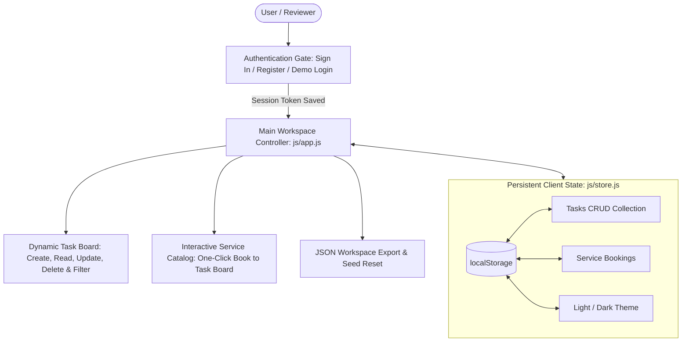

# TaskFlow Pro — Production Capstone SaaS Workspace

A production-ready, zero-dependency Web Application Capstone synthesizing **Mobile-First CSS Design Tokens**, **ES6+ Modular JavaScript**, **Client-Side Authentication Simulation**, **Dynamic CRUD Operations**, **Interactive Service Booking Catalog**, and **Persistent `localStorage` State**.

---

## Architecture Diagram



---

## Folder Structure

```text
production-capstone-saas-workspace/
├── index.html          # Semantic SPA shell (Auth screen, Workspace, CRUD Modal)
├── css/
│   ├── tokens.css      # :root design tokens & Light/Dark theme custom properties
│   └── styles.css      # Mobile-first responsive Grid/Flexbox & glassmorphism UI
├── js/
│   ├── store.js        # Persistent state manager (Auth, CRUD tasks, bookings, seed data)
│   └── app.js          # UI controller, real-time filtering, modal CRUD & event delegation
├── vercel.json         # Production deployment config for Vercel
├── netlify.toml        # Production deployment config for Netlify
└── README.md           # Architecture, setup & deployment guide
```

---

## Feature Highlights
1. **Authentication Simulation (`js/store.js` & `js/app.js`):** Full Sign-In, Account Registration, session persistence across page reloads, and a **One-Click Demo Login** for instant capstone evaluation.
2. **Dynamic CRUD Task Manager:** Create, edit, advance status (`To Do` &rarr; `In Progress` &rarr; `Completed`), delete, and filter tasks in real time by keyword, status, and priority.
3. **Interactive Service Catalog:** Browse categorized cloud/freelancer services and book any package directly into your active Task Board.
4. **Live KPI Strip & JSON Portability:** Real-time metrics counter plus one-click JSON backup export and seed data reset.

---

## Local Setup Instructions

Because this project uses native ES6 Modules (`type="module"`), serve it over a local HTTP server:

```bash
# Option 1: Using Node.js serve
npx serve .

# Option 2: Using Python
python -m http.server 8080
```
Then open `http://localhost:8080` in your browser.

---

## Live Cloud Deployment Guide

### Option A: Deploy to Vercel
1. Push this folder to a new **GitHub repository**.
2. Go to [vercel.com/new](https://vercel.com/new), import your GitHub repo, and click **Deploy** (uses `vercel.json` automatically).

### Option B: Deploy to Netlify
1. Log in to [app.netlify.com](https://app.netlify.com) and click **Add new site &rarr; Import an existing project** (or drag-and-drop this folder into Netlify Drop).
2. Publish directory is `.` (pre-configured in `netlify.toml`).

### Option C: Deploy to Cloudflare Pages
1. Open **Cloudflare Dashboard &rarr; Workers & Pages &rarr; Create &rarr; Pages &rarr; Connect to Git**.
2. Select your repository, leave build command blank, set build output directory to `/`, and click **Save and Deploy**.
